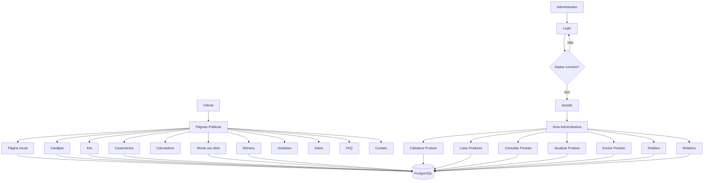

# Elis Patisserie


## *Contextualização*

### 1. Introdução

Com o crescimento das compras e dos pedidos realizados pela internet, muitas confeitarias passaram a precisar de sistemas que não sirvam apenas para divulgar seus produtos, mas também para ajudar na organização do cardápio, dos pedidos e das informações do negócio.

O projeto "Elis Patisserie" nasce dessa ideia. Trata-se de um sistema web para uma confeitaria inspirada na pâtisserie francesa e na estética retrô dos anos 50, 60 e 70. O site apresenta produtos como bolos, tortas, macarons, sobremesas individuais, kits comemorativos e produtos para casamentos, além de permitir que o cliente faça pedidos e monte um bolo personalizado.

### 2. Razão de eu escolher a Confeitaria

Confeitarias que controlam seus produtos e pedidos de forma manual podem acabar utilizando cadernos, planilhas ou anotações separadas. Esse modelo pode gerar problemas como:

- Dificuldade em manter o cardápio atualizado;<BR>
- Falta de controle sobre produtos ativos e inativos;<BR>
- Dificuldade em acompanhar os pedidos recebidos;<BR>
- Falhas na atualização do status dos pedidos;<BR>
- Estoque desatualizado dos produtos;<BR>
- Ausência de relatórios que auxiliem na organização da confeitaria.

Além disso, eu queria desenvolver um projeto em que eu pudesse trabalhar tanto a parte de programação e banco de dados quanto a parte visual. Por isso escolhi uma confeitaria com técnica francesa e uma identidade retrô, usando tons pastel e referências das décadas de 1950, 1960 e 1970.

### 3. Objetivos

#### 3.1 Objetivo Geral

Desenvolver um sistema web para uma confeitaria, permitindo a apresentação e consulta dos produtos, o registro de pedidos e o gerenciamento das informações pela área administrativa.

#### 3.2 Objetivos Específicos

- Cadastrar e gerenciar produtos da confeitaria;
- Permitir a consulta e o filtro dos produtos do cardápio;
- Registrar pedidos de delivery, retirada e bolo personalizado;
- Criar uma calculadora de quantidade de bolo e docinhos;
- Controlar o acesso à área administrativa;
- Permitir a atualização do status dos pedidos;
- Gerar relatórios que auxiliem na organização dos produtos e pedidos;
- Manter uma identidade visual coerente com o tema retrô e a confeitaria francesa.

### 4. Tecnologias Utilizadas

|Tecnologia|Finalidade|
|----------|----------|
|PHP|Linguagem de programação do back-end|
|Moba/PSQL / PostgreSQL|Armazenamento dos dados|
|PDO|Conexão entre PHP e PostgreSQL|
|HTML5, CSS|Construção e estilização da interface|
|Visual Studio Code|Ambiente de desenvolvimento|

--------------------------------------------

## *Requisitos do Sistema*

### *Requisitos Funcionais*

|Requisitos|Explicação|
|----------|----------|
|RF01|O sistema deve permitir o cadastro, consulta, atualização e exclusão de produtos (nome, categoria, preço, estoque, unidade, descrição, rendimento, alérgenos, imagem e ativo).|
|RF02|O sistema deve permitir login e logout do administrador.|
|RF03|O sistema deve permitir listar os produtos e filtrar o cardápio por categoria e unidade.|
|RF04|O sistema deve exibir produtos específicos nas páginas de Kits Comemorativos e Casamentos.|
|RF05|O sistema deve permitir calcular uma sugestão de bolo e docinhos de acordo com o número de convidados.|
|RF06|O sistema deve permitir montar um bolo personalizado e calcular o valor de acordo com o peso escolhido.|
|RF07|O sistema deve registrar pedidos de delivery, retirada e bolo personalizado, contendo cliente, produto, quantidade, unidade, data, período, status e total.|
|RF08|O sistema deve exibir os pedidos cadastrados, permitir atualizar o status de cada pedido e gerar um relatório de produtos, estoque e pedidos.|

### *Requisitos Não Funcionais*

|Requisitos|Explicação|
|----------|----------|
|RNF01|O sistema deve ser desenvolvido em PHP, usando o VS Code como ambiente de desenvolvimento.|
|RNF02|Os dados devem ser armazenados em um banco de dados relacional PostgreSQL.|
|RNF03|A comunicação entre PHP e PostgreSQL deve ser feita utilizando PDO.|
|RNF04|As consultas que recebem valores devem utilizar prepared statements com `prepare()` e `bindParam()`.|
|RNF05|O acesso às funcionalidades administrativas deve ser controlado por sessão.|
|RNF06|A estrutura do projeto deve separar as páginas públicas, administração, login, banco, funções, imagens e estilos.|
|RNF07|A interface deve utilizar `meta viewport`, larguras máximas e imagens ajustáveis para melhorar a visualização.|
|RNF08|A interface deve ser intuitiva e possuir uma identidade visual coerente com o tema retrô e a confeitaria francesa.|
|RNF09|Os formulários devem indicar os campos obrigatórios utilizando `required`.|
|RNF10|O sistema deve ser compatível com os principais navegadores atuais.|
|RNF11|Os produtos e pedidos devem permanecer armazenados no PostgreSQL após o navegador ser fechado.|
|RNF12|Os componentes repetidos, como cabeçalho, rodapé e funções, devem ficar separados para facilitar alterações.|
|RNF13|O código deve possuir comentários que auxiliem sua leitura e manutenção.|
|RNF14|As credenciais reais do PostgreSQL não devem ser publicadas em um repositório público.|

## *Organização do código*

```texto
elis-patisserie/
├── index.php                  *página inicial da confeitaria*
├── cardapio.php               *cardápio e filtros dos produtos*
├── kits.php                   *exibição dos Kits Comemorativos*
├── casamentos.php             *exibição dos produtos para Casamentos*
├── calculadora.php            *cálculo de bolo e docinhos*
├── monte-bolo.php             *montagem e cadastro do bolo personalizado*
├── delivery.php               *registro de pedidos de delivery e retirada*
├── unidades.php               *informações das unidades da confeitaria*
├── sobre.php                  *informações sobre a Elis Patisserie*
├── faq.php                    *perguntas frequentes*
├── contato.php                *informações de contato*
├── documentacao.md            *arquivo de documentação geral do projeto*
├── app/                       *gerenciamento do sistema*
│   ├── pedidos.php            *listagem e atualização dos pedidos*
│   ├── produto-cadastrar.php  *cadastro de produtos*
│   ├── produto-listar.php     *listagem de produtos*
│   ├── produto-consultar.php  *consulta de produto pelo ID*
│   ├── produto-atualizar.php  *atualização/edição de produtos*
│   ├── produto-excluir.php    *exclusão de produtos*
│   └── relatorio.php          *relatório de produtos e pedidos*
├── imagens/                   *imagens utilizadas no site*
├── database/                  *camada de persistência de dados*
│   ├── connect.php            *script de conexão com o banco de dados*
│   └── dados.pgsql            *estrutura e dados utilizados no PostgreSQL*
├── includes/                  *componentes reutilizáveis de interface e lógica*
│   ├── footer.php             *rodapé compartilhado do site*
│   ├── functions.php          *funções utilizadas pelo sistema*
│   ├── header.php             *cabeçalho da parte pública*
│   └── header_admin.php       *cabeçalho da área administrativa*
├── login/                     *controle de autenticação e segurança*
│   ├── login.php              *login do administrador*
│   ├── logout.php             *desconexão do administrador*
│   └── verifica_user.php      *verificação da sessão*
├── style/                     *arquivos de estilização CSS*
└──   └── style.css            *layout das páginas*
```

## *Diagrama do Sistema*



## *Como entrar no meu projeto*

### 1. Preparar a aplicação

#### Pré-requisitos

- PHP instalado e disponível no `Path` do Windows, com as extensões `PDO` e `pdo_pgsql` habilitadas e suporte a sessões.
- PostgreSQL instalado e em execução no servidor Linux, com o comando `psql` disponível no terminal remoto.
- MobaXterm e acesso SSH ao servidor, com permissão para preparar o banco.
- Git, caso o projeto seja obtido por clonagem.
- Navegador web no Windows.

#### 1.1. Obter o projeto

No PowerShell ou terminal PowerShell do VS Code:

```powershell
git clone https://github.com/elisperin/elis-patisserie elis-patisserie
Set-Location .\elis-patisserie
```

A clonagem exige acesso ao repositório. Se já possui os arquivos, abra no VS Code a pasta `elis-patisserie`.

Confira a presença de:

```text
database/connect.php
database/dados.pgsql
```

Caso não existam, obtenha os arquivos do banco e da conexão antes de prosseguir.

#### 1.2. Conferir os caminhos da conexão

A pasta atual do banco é:

```text
database/
```

O arquivo `includes/functions.php` utiliza:

```php
require_once __DIR__ . '/../database/connect.php';
```

para carregar a conexão com o PostgreSQL.

As páginas administrativas também utilizam:

```php
require_once __DIR__ . '/../login/verifica_user.php';
```

para verificar a sessão do administrador.

Confira esses caminhos antes de iniciar a aplicação.

### 2. Configurar banco

O projeto utiliza o banco:

```text
elis_patisserie
```

Os comandos utilizados para criar as tabelas e os dados estão em:

```text
database/dados.pgsql
```

#### 2.1. Criar o usuário e o banco

No terminal remoto do MobaXterm, entre no PostgreSQL:

```bash
sudo -u postgres psql -p 5432
```

Dentro do `psql`, crie o usuário utilizado pela aplicação:

```sql
CREATE USER elis_app WITH PASSWORD 'elis123';
```

Depois crie o banco `elis_patisserie` e coloque `elis_app` como proprietário:

```sql
CREATE DATABASE elis_patisserie OWNER elis_app;
```

Para sair do PostgreSQL:

```text
\q
```

A aplicação utilizará o usuário:

```text
elis_app
```

em vez do usuário administrativo `postgres`.

#### 2.2. Restaurar o banco

O arquivo utilizado pelo projeto para criar a estrutura e os dados é:

```text
database/dados.pgsql
```

Antes da primeira execução, abra esse arquivo no VS Code e deixe ativos os comandos `CREATE TABLE` e os `INSERT` que serão utilizados no banco.

No terminal, dentro da pasta do projeto, execute:

```bash
psql -h localhost -U elis_app -d elis_patisserie -f database/dados.pgsql
```

Quando aparecer:

```text
Password for user elis_app:
```

digite a senha definida anteriormente:

```text
elis123
```

O acesso da aplicação utilizará o usuário `elis_app` no banco `elis_patisserie`.

### 3. Conectar ao banco e abrir no localhost

#### 3.1. Configurar o arquivo de conexão

No VS Code, abra:

```text
database/connect.php
```

Para utilizar a configuração do banco, altere as seguintes partes:

```php
<?php

$host = "IP_DO_BANCO/SERVIDOR";
$dbname = "elis_patisserie";
$user = "elis_app";
$pass = "elis123";

?>
```

- `$host` recebe o endereço do servidor PostgreSQL;
- `$dbname` recebe o nome do banco;
- `$user` recebe o usuário criado para a aplicação;
- `$pass` recebe a senha desse usuário.

Caso o banco esteja no mesmo computador, o host pode ser:

```php
$host = "localhost";
```

Caso esteja no servidor da escola, utilize o IP/endereço correspondente.

Antes de publicar o projeto no GitHub, retire a senha real do arquivo `connect.php`.

#### 3.2. Iniciar o PHP pelo PowerShell

No VS Code, abra um terminal **PowerShell na pasta que contém a pasta `elis-patisserie`**.

Execute:

```powershell
php -S localhost:8000
```

Abra:

```text
http://localhost:8000/elis-patisserie/
```

no navegador.

Para acessar diretamente a área administrativa:

```text
http://localhost:8000/elis-patisserie/login/login.php
```

#### 3.3. Criar o primeiro acesso e conferir

Caso o arquivo do banco ainda não tenha um usuário administrativo, abra um **New Query** conectado ao banco `elis_patisserie` e execute:

```sql
INSERT INTO usuarios
(email, senha)
VALUES
(
    'admin@elispatisserie.com',
    'elis123'
);
```

Depois:

1. Abra `/login/login.php` e entre com o e-mail e a senha cadastrados.
2. Acesse `/app/produto-cadastrar.php` para cadastrar um produto.
3. Confira o produto em `/app/produto-listar.php`.
4. Em `/app/produto-consultar.php`, informe o ID para consultar o produto.
5. Em `/app/produto-atualizar.php`, informe o ID e altere os dados desejados.
6. Em `/app/produto-excluir.php`, informe o ID para excluir um produto.
7. Faça um pedido em `/delivery.php` ou `/monte-bolo.php`.
8. Acesse `/app/pedidos.php` para conferir e atualizar o status do pedido.
9. Acesse `/app/relatorio.php` para visualizar o relatório.

A senha do administrador é armazenada em texto simples no esquema atual. Use somente credenciais de teste enquanto essa pendência existir.

Para encerrar, pressione `Ctrl+C` no terminal do PHP. Os dados permanecem salvos no PostgreSQL.

#### 3.4. Problemas comuns

| Problema | O que conferir |
|---|---|
| `php` não é reconhecido | PHP disponível no `Path` do Windows, conforme os pré-requisitos. |
| `could not find driver` | Extensão `pdo_pgsql` habilitada na instalação PHP utilizada. |
| Conexão recusada | Endereço do PostgreSQL informado em `$host` e servidor em execução. |
| Falha de autenticação | Usuário, nome do banco ou senha informados em `connect.php`. |
| `database "elis_patisserie" does not exist` | Banco criado conforme a seção 2.1. |
| `relation "produtos" does not exist` | Arquivo `dados.pgsql` executado no banco correto. |
| `relation "pedidos" does not exist` | Arquivo `dados.pgsql` executado no banco correto. |
| `relation "usuarios" does not exist` | Arquivo `dados.pgsql` executado no banco correto. |
| `permission denied` | Banco e tabelas pertencendo ao usuário `elis_app`. |
| Usuário ou senha inválidos | E-mail e senha cadastrados na tabela `usuarios`. |
| Produto não aparece | Campo `ativo`, categoria e unidade cadastrados. |
| Pedido não aparece | Conexão com o banco e cadastro do pedido. |
| Imagem não aparece | Caminho salvo no campo `imagem` e arquivo correspondente na pasta `imagens/`. |
| Página sem estilo ou links quebrados | Pasta principal com o nome `elis-patisserie`. |

Esses passos são um roteiro de verificação; o funcionamento completo ainda deve ser conferido no ambiente real.
