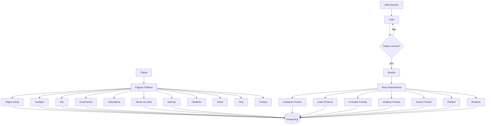

# Elis Patisserie

## *Contextualização*

### 1. Introdução

Com o crescimento das compras e dos pedidos realizados pela internet, muitas confeitarias passaram a precisar de sistemas que não sirvam apenas para divulgar seus produtos, mas também para ajudar na organização do cardápio, dos pedidos e das informações do negócio.

O projeto **"Elis Patisserie"** nasce dessa ideia. Trata-se de um sistema web para uma confeitaria inspirada na pâtisserie francesa e na estética retrô dos anos 50, 60 e 70.

O site apresenta produtos como bolos, tortas, macarons, sobremesas individuais, kits comemorativos e doces para casamentos, além de permitir que o cliente consulte o cardápio, faça pedidos, utilize uma calculadora e monte um bolo personalizado.

Também existe uma área administrativa separada da parte pública, onde é possível cadastrar, consultar, atualizar e excluir produtos, acompanhar os pedidos, alterar seus status e visualizar um relatório geral.

### 2. Razão de eu escolher a Confeitaria

Confeitarias que controlam seus produtos e pedidos de forma manual podem acabar utilizando cadernos, planilhas ou anotações separadas. Esse modelo pode gerar problemas como:

- Dificuldade em manter o cardápio atualizado;<BR>
- Falta de controle sobre produtos ativos e inativos;<BR>
- Dificuldade em acompanhar os pedidos recebidos;<BR>
- Falhas na atualização do status dos pedidos;<BR>
- Estoque desatualizado dos produtos;<BR>
- Informações espalhadas em diferentes lugares;<BR>
- Ausência de relatórios que ajudem na organização da confeitaria.

Além disso, eu queria desenvolver um projeto em que eu pudesse trabalhar tanto a parte de programação e banco de dados quanto a parte visual.

Por isso escolhi uma confeitaria com técnica francesa e uma identidade retrô, usando tons pastel, imagens inspiradas em propagandas antigas e referências das décadas de 1950, 1960 e 1970.

### 3. Objetivos

#### 3.1 Objetivo Geral

Desenvolver um sistema web para uma confeitaria, permitindo a apresentação e consulta dos produtos, o registro de pedidos e o gerenciamento das informações pela área administrativa.

#### 3.2 Objetivos Específicos

- Cadastrar e gerenciar produtos da confeitaria;
- Permitir a consulta dos produtos;
- Permitir filtrar o cardápio por categoria e unidade;
- Separar produtos específicos de Kits e Casamentos;
- Registrar pedidos de delivery e retirada;
- Permitir a montagem de um bolo personalizado;
- Criar uma calculadora de quantidade de bolo e docinhos;
- Calcular automaticamente valores de pedidos;
- Controlar o acesso à área administrativa;
- Implementar o CRUD completo de produtos;
- Permitir a atualização do status dos pedidos;
- Gerar um relatório de produtos, estoque e pedidos;
- Armazenar as informações utilizando PostgreSQL;
- Integrar PHP e PostgreSQL utilizando PDO;
- Manter uma identidade visual coerente com o tema retrô e com a confeitaria francesa.

### 4. Tecnologias Utilizadas

|Tecnologia|Finalidade|
|----------|----------|
|PHP|Linguagem de programação utilizada no back-end|
|Moba/PSQL / PostgreSQL|Armazenamento dos dados|
|PDO|Conexão entre PHP e PostgreSQL|
|HTML5|Construção da estrutura das páginas|
|CSS|Estilização e identidade visual|
|Visual Studio Code|Ambiente de desenvolvimento|

--------------------------------------------

## *Requisitos do Sistema*

### *Requisitos Funcionais*

|Requisitos|Explicação|
|----------|----------|
|RF01|O sistema deve permitir o cadastro, consulta, atualização e exclusão de produtos (nome, categoria, preço, estoque, unidade, descrição, rendimento, alérgenos, imagem e ativo).|
|RF02|O sistema deve permitir login e logout do administrador.|
|RF03|O sistema deve permitir listar os produtos e filtrar o cardápio por categoria e unidade.|
|RF04|O sistema deve exibir somente produtos ativos na parte pública correspondente.|
|RF05|O sistema deve exibir produtos específicos na página de Kits Comemorativos.|
|RF06|O sistema deve exibir produtos específicos na página de Casamentos.|
|RF07|O sistema deve permitir calcular uma sugestão de bolo e docinhos de acordo com o número de convidados.|
|RF08|O sistema deve permitir montar um bolo personalizado escolhendo peso, massa, recheio, cobertura e decoração.|
|RF09|O sistema deve calcular o valor do bolo personalizado de acordo com o peso escolhido.|
|RF10|O sistema deve registrar o bolo personalizado na tabela de pedidos.|
|RF11|O sistema deve permitir selecionar produtos ativos no Delivery.|
|RF12|O sistema deve registrar pedidos de delivery e retirada.|
|RF13|O sistema deve calcular o valor do pedido utilizando o preço do produto e a quantidade.|
|RF14|O sistema deve permitir selecionar uma das unidades da confeitaria.|
|RF15|O sistema deve exibir informações sobre as unidades de Americana-SP, Leblon-RJ e Monte Verde-MG.|
|RF16|O sistema deve possuir páginas de Sobre, FAQ e Contato.|
|RF17|O sistema deve proteger as páginas administrativas utilizando sessão.|
|RF18|O sistema deve listar os pedidos cadastrados.|
|RF19|O sistema deve permitir atualizar o status dos pedidos pelo ID.|
|RF20|O sistema deve gerar um relatório com informações de produtos, estoque e pedidos.|

### *Requisitos Não Funcionais*

|Requisitos|Explicação|
|----------|----------|
|RNF01|O sistema deve ser desenvolvido em PHP, utilizando o VS Code como ambiente de desenvolvimento.|
|RNF02|Os dados devem ser armazenados em um banco de dados relacional PostgreSQL.|
|RNF03|A comunicação entre PHP e PostgreSQL deve ser feita utilizando PDO.|
|RNF04|As consultas que recebem valores devem utilizar `prepare()` e `bindParam()`.|
|RNF05|O acesso às funcionalidades administrativas deve ser controlado por sessão.|
|RNF06|A estrutura do sistema deve separar páginas públicas, administração, login, banco de dados, funções, imagens e estilos.|
|RNF07|A interface deve utilizar `meta viewport`, larguras máximas e imagens ajustáveis para melhorar a visualização.|
|RNF08|A interface deve ser intuitiva e manter uma identidade visual coerente com o tema retrô e francês.|
|RNF09|Os formulários devem utilizar `required` nos campos obrigatórios.|
|RNF10|Campos de ID ou quantidade que não podem ser menores que 1 devem utilizar valor mínimo.|
|RNF11|Os produtos e pedidos devem continuar armazenados após o navegador ser fechado.|
|RNF12|Partes utilizadas em várias páginas devem ser separadas em arquivos reutilizáveis.|
|RNF13|O código deve possuir comentários que auxiliem sua leitura e explicação.|
|RNF14|As credenciais reais do PostgreSQL não devem ser publicadas em um repositório público.|

## *Organização do código*

```texto
elis-patisserie/
├── index.php                  *página inicial da confeitaria*
├── cardapio.php               *cardápio e filtros dos produtos*
├── kits.php                   *exibição dos Kits Comemorativos*
├── casamentos.php             *exibição dos produtos para Casamentos*
├── calculadora.php            *cálculo de bolo e docinhos*
├── monte-bolo.php             *montagem e cadastro do bolo personalizado*
├── delivery.php               *registro de pedidos de delivery e retirada*
├── unidades.php               *informações das unidades da confeitaria*
├── sobre.php                  *informações sobre a Elis Patisserie*
├── faq.php                    *perguntas frequentes*
├── contato.php                *informações de contato*
├── documentacao.md            *documentação geral do projeto*
│
├── app/                       *gerenciamento do sistema*
│   ├── pedidos.php            *listagem e atualização dos pedidos*
│   ├── produto-cadastrar.php  *cadastro de produtos*
│   ├── produto-listar.php     *listagem de produtos*
│   ├── produto-consultar.php  *consulta de produto por ID*
│   ├── produto-atualizar.php  *atualização/edição de produtos*
│   ├── produto-excluir.php    *exclusão de produtos*
│   └── relatorio.php          *relatório de produtos e pedidos*
│
├── database/                  *camada de persistência de dados*
│   ├── connect.php            *script de conexão com o banco*
│   └── dados.pgsql            *criação das tabelas, dados e testes SQL*
│
├── includes/                  *componentes reutilizáveis*
│   ├── footer.php             *rodapé compartilhado*
│   ├── functions.php          *funções utilizadas pelo sistema*
│   ├── header.php             *cabeçalho da parte pública*
│   └── header_admin.php       *cabeçalho da área administrativa*
│
├── login/                     *controle de autenticação*
│   ├── login.php              *login do administrador*
│   ├── logout.php             *desconexão do administrador*
│   └── verifica_user.php      *verificação da sessão*
│
├── imagens/                   *imagens utilizadas no site*
│
└── style/                     *arquivos de estilização CSS*
    └── style.css              *layout das páginas*
```

## *Diagrama do Sistema*



## *Como entrar no meu projeto*

### 1. Preparar a aplicação

Antes de abrir o site, é necessário preparar o PHP, o PostgreSQL, o banco de dados e a conexão do projeto.

#### Pré-requisitos

Para executar o projeto, é necessário ter:

- PHP instalado no Windows;
- PHP disponível no `Path` do Windows;
- Extensão `PDO` habilitada;
- Extensão `pdo_pgsql` habilitada;
- PostgreSQL disponível no servidor;
- MobaXterm para acessar o servidor PostgreSQL utilizado;
- Visual Studio Code;
- Git, caso o projeto seja baixado pelo GitHub;
- Navegador web como Chrome ou Edge.

#### 1.1. Conferir se o PHP está funcionando

Abra o **Visual Studio Code**.

No menu superior, clique em:

```text
Terminal
```

Depois:

```text
New Terminal
```

No terminal PowerShell que abrir na parte inferior do VS Code, digite:

```powershell
php --version
```

e pressione **Enter**.

Se o PHP estiver instalado corretamente, aparecerá algo parecido com:

```text
PHP 8.x.x
```

Se aparecer:

```text
php não é reconhecido
```

o PHP ainda não está disponível no `Path` do Windows.

Nesse caso, o PHP precisa ser instalado ou adicionado ao `Path` antes de continuar.

#### 1.2. Conferir se o PHP consegue utilizar PostgreSQL

No mesmo terminal PowerShell, digite:

```powershell
php -m | Select-String "PDO|pdo_pgsql"
```

Pressione **Enter**.

O resultado deve mostrar:

```text
PDO
pdo_pgsql
```

Se `pdo_pgsql` não aparecer, o PHP não conseguirá se conectar ao PostgreSQL.

#### 1.3. Conferir se o Git está funcionando

No terminal, digite:

```powershell
git --version
```

Se estiver instalado, aparecerá uma versão do Git.

Caso o projeto já esteja no computador, essa etapa não é necessária para executar o site.

#### 1.4. Obter o projeto

Caso o projeto esteja no GitHub, vá até a pasta onde deseja armazená-lo.

Depois execute:

```powershell
git clone URL_DO_REPOSITORIO elis-patisserie
```

Substitua:

```text
URL_DO_REPOSITORIO
```

pelo link real do repositório no GitHub.

Depois entre na pasta:

```powershell
Set-Location .\elis-patisserie
```

Se o projeto já estiver no computador:

1. Abra o Visual Studio Code;
2. Clique em **File**;
3. Clique em **Open Folder**;
4. Escolha a pasta:

```text
elis-patisserie
```

A pasta deve possuir arquivos como:

```text
index.php
cardapio.php
delivery.php
app/
database/
includes/
login/
style/
imagens/
```

#### 1.5. Conferir os arquivos do banco

Dentro do VS Code, abra:

```text
database/
```

Essa pasta precisa possuir:

```text
connect.php
dados.pgsql
```

O arquivo:

```text
connect.php
```

é responsável pela conexão do PHP com o PostgreSQL.

O arquivo:

```text
dados.pgsql
```

possui os comandos utilizados para criar as tabelas, inserir registros e testar o banco.

### 2. Configurar banco

O projeto utiliza PostgreSQL.

O banco usado pelo site se chama:

```text
elis_patisserie
```

As principais tabelas são:

```text
produtos
pedidos
usuarios
```

Antes de iniciar o site, será necessário:

```text
1. entrar no PostgreSQL;
2. criar um usuário para a aplicação;
3. criar o banco elis_patisserie;
4. testar esse usuário;
5. criar as tabelas;
6. inserir os produtos;
7. criar o usuário administrador do site.
```

#### 2.1. Abrir o MobaXterm

Abra:

```text
MobaXterm
```

Conecte-se ao servidor utilizado pelo PostgreSQL.

Depois de entrar, aparecerá um terminal.

Os próximos comandos serão executados nesse terminal.

#### 2.2. Entrar no PostgreSQL como administrador

No terminal do MobaXterm, digite:

```bash
sudo -u postgres psql
```

Pressione **Enter**.

Se funcionar, a linha ficará parecida com:

```text
postgres=#
```

Isso significa que você entrou no PostgreSQL como administrador.

O usuário `postgres` será utilizado somente para preparar o banco.

A aplicação terá outro usuário.

#### 2.3. Criar o usuário da aplicação

Enquanto aparecer:

```text
postgres=#
```

digite:

```sql
CREATE USER elis_app WITH PASSWORD 'elis123';
```

Pressione **Enter**.

Se funcionar, aparecerá:

```text
CREATE ROLE
```

O usuário criado será:

```text
Usuário: elis_app
Senha: elis123
```

A senha é simples porque esse é um projeto escolar.

Para um sistema real, deve ser utilizada uma senha mais segura.

#### 2.4. Criar o banco de dados

Ainda dentro do PostgreSQL, digite:

```sql
CREATE DATABASE elis_patisserie OWNER elis_app;
```

Pressione **Enter**.

Se funcionar, aparecerá:

```text
CREATE DATABASE
```

O banco criado será:

```text
elis_patisserie
```

E o usuário:

```text
elis_app
```

será o dono dele.

#### 2.5. Sair do PostgreSQL

Digite:

```text
\q
```

Pressione **Enter**.

Agora você voltou ao terminal normal do servidor.

#### 2.6. Testar o usuário criado

Digite:

```bash
psql -h localhost -U elis_app -d elis_patisserie
```

Pressione **Enter**.

O PostgreSQL pedirá:

```text
Password for user elis_app:
```

Digite:

```text
elis123
```

A senha não aparece visualmente enquanto é digitada.

Isso é normal.

Depois pressione **Enter**.

Se aparecer:

```text
elis_patisserie=>
```

a conexão funcionou.

Isso significa que você está usando:

```text
Banco: elis_patisserie
Usuário: elis_app
```

Para sair:

```text
\q
```

### 3. Criar as tabelas

Agora é necessário criar as tabelas utilizadas pelo site.

As tabelas são:

```text
produtos
pedidos
usuarios
```

As tabelas devem ser criadas usando o usuário:

```text
elis_app
```

#### 3.1. Abrir o PostgreSQL Explorer

No Visual Studio Code, abra o **PostgreSQL Explorer**.

Crie ou abra uma conexão utilizando:

```text
Host: endereço do servidor PostgreSQL
Database: elis_patisserie
User: elis_app
Password: elis123
```

Abra o banco:

```text
elis_patisserie
```

Depois clique em:

```text
New Query
```

Antes de executar qualquer comando, confira se o Query está conectado ao banco:

```text
elis_patisserie
```

#### 3.2. Criar a tabela produtos

No **New Query**, cole:

```sql
CREATE TABLE produtos(
    id SERIAL PRIMARY KEY NOT NULL,
    nome VARCHAR(80) NOT NULL,
    categoria VARCHAR(60) NOT NULL,
    preco VARCHAR(20) NOT NULL,
    estoque VARCHAR(20) NOT NULL,
    unidade VARCHAR(60) NOT NULL,
    descricao TEXT,
    rendimento VARCHAR(80),
    alergenos VARCHAR(120),
    imagem VARCHAR(100),
    ativo BOOLEAN
);
```

Execute.

Essa tabela armazena os produtos da confeitaria.

#### 3.3. Criar a tabela pedidos

No **New Query**, execute:

```sql
CREATE TABLE pedidos(
    id SERIAL PRIMARY KEY NOT NULL,
    cliente VARCHAR(100) NOT NULL,
    email VARCHAR(100) NOT NULL,
    telefone VARCHAR(30) NOT NULL,
    produto TEXT NOT NULL,
    quantidade VARCHAR(20) NOT NULL,
    unidade VARCHAR(60) NOT NULL,
    tipo_recebimento VARCHAR(50) NOT NULL,
    data_retirada DATE,
    periodo VARCHAR(30),
    observacao TEXT,
    status VARCHAR(50),
    total VARCHAR(30)
);
```

Essa tabela armazena os pedidos feitos pelo:

```text
Delivery
```

e:

```text
Monte seu Bolo
```

#### 3.4. Criar a tabela usuarios

No **New Query**, execute:

```sql
CREATE TABLE usuarios(
    id SERIAL PRIMARY KEY NOT NULL,
    email VARCHAR(100) NOT NULL,
    senha VARCHAR(60) NOT NULL
);
```

Essa tabela armazena o usuário utilizado para entrar na área administrativa.

#### 3.5. Conferir as tabelas

Execute:

```sql
SELECT * FROM produtos;
```

Depois:

```sql
SELECT * FROM pedidos;
```

Depois:

```sql
SELECT * FROM usuarios;
```

Se nenhum deles apresentar erro dizendo:

```text
relation does not exist
```

as tabelas foram criadas.

Elas podem estar vazias.

Isso é normal.

### 4. Inserir os produtos

Abra:

```text
database/dados.pgsql
```

Nesse arquivo estão os comandos utilizados para colocar os produtos da Elis Patisserie no banco.

Eles começam com:

```sql
INSERT INTO produtos
```

Para utilizar os produtos:

1. Abra `database/dados.pgsql`;
2. Localize os `INSERT INTO produtos`;
3. Abra um **New Query**;
4. Confira se está conectado ao banco `elis_patisserie`;
5. Confira se está usando o usuário `elis_app`;
6. Cole os comandos;
7. Execute.

Depois confira:

```sql
SELECT * FROM produtos;
```

Os produtos devem aparecer na consulta.

### 5. Criar o administrador do site

A área administrativa precisa de um registro na tabela:

```text
usuarios
```

Abra um **New Query**.

Execute:

```sql
INSERT INTO usuarios
(email, senha)
VALUES
(
    'admin@elispatisserie.com',
    'elis123'
);
```

Depois execute:

```sql
SELECT * FROM usuarios;
```

Deve aparecer um registro semelhante a:

```text
id | email                     | senha
1  | admin@elispatisserie.com | elis123
```

Os dados de acesso serão:

```text
E-mail: admin@elispatisserie.com
Senha: elis123
```

A senha é armazenada em texto simples na versão atual.

Por isso, esses dados devem ser utilizados somente no ambiente escolar e de testes.

### 6. Configurar a conexão do PHP

Abra:

```text
database/connect.php
```

A estrutura deve ficar assim:

```php
<?php

$host = "IP_DO_SERVIDOR";
$dbname = "elis_patisserie";
$user = "elis_app";
$pass = "elis123";

try {

    $conexao = new PDO(
        "pgsql:host=$host;dbname=$dbname",
        $user,
        $pass
    );

    return $conexao;

} catch (PDOException $e) {

    echo "Erro: " . $e->getMessage();
}

?>
```

Agora substitua:

```text
IP_DO_SERVIDOR
```

pelo endereço onde está o PostgreSQL.

Se o banco estiver no mesmo computador:

```php
$host = "localhost";
```

Se o banco estiver em um servidor da escola, utilize o IP/endereço desse servidor.

As outras configurações serão:

```php
$dbname = "elis_patisserie";
$user = "elis_app";
$pass = "elis123";
```

Salve usando:

```text
Ctrl + S
```

Antes de publicar o projeto no GitHub, retire a senha real do arquivo `connect.php`.

### 7. Conferir os caminhos

O projeto utiliza caminhos que começam com:

```text
/elis-patisserie/
```

Por isso a pasta principal deve continuar com o nome:

```text
elis-patisserie
```

Exemplo correto:

```text
projetos/
└── elis-patisserie/
    ├── index.php
    ├── cardapio.php
    ├── app/
    ├── database/
    ├── includes/
    ├── login/
    ├── imagens/
    └── style/
```

Não altere o nome da pasta sem também alterar os caminhos do código.

### 8. Iniciar o PHP

O terminal deve ser aberto na pasta que contém:

```text
elis-patisserie/
```

Exemplo:

```text
projetos/
└── elis-patisserie/
```

O PowerShell deve estar em:

```text
projetos/
```

No terminal, execute:

```powershell
php -S localhost:8000
```

Pressione **Enter**.

Deixe o terminal aberto enquanto o site estiver sendo utilizado.

### 9. Abrir o site

Abra o navegador.

Digite:

```text
http://localhost:8000/elis-patisserie/
```

ou:

```text
http://localhost:8000/elis-patisserie/index.php
```

A página inicial da Elis Patisserie deve aparecer.

### 10. Conferir a parte pública

#### 10.1. Página inicial

Abra:

```text
http://localhost:8000/elis-patisserie/index.php
```

A página deve apresentar:

- Capa;
- Identidade visual;
- Informações da confeitaria;
- Produtos em destaque;
- Menu.

#### 10.2. Cardápio

Abra:

```text
http://localhost:8000/elis-patisserie/cardapio.php
```

Teste:

```text
Categoria
```

e:

```text
Unidade
```

Os produtos devem mudar de acordo com o filtro.

#### 10.3. Kits

Abra:

```text
http://localhost:8000/elis-patisserie/kits.php
```

Devem aparecer produtos da categoria:

```text
Kits Comemorativos
```

#### 10.4. Casamentos

Abra:

```text
http://localhost:8000/elis-patisserie/casamentos.php
```

Devem aparecer produtos da categoria:

```text
Casamentos
```

#### 10.5. Calculadora

Abra:

```text
http://localhost:8000/elis-patisserie/calculadora.php
```

Digite:

```text
20
```

convidados.

O resultado esperado é:

```text
2 kg de bolo
80 docinhos
```

#### 10.6. Monte seu bolo

Abra:

```text
http://localhost:8000/elis-patisserie/monte-bolo.php
```

Preencha o formulário.

Por exemplo:

```text
Peso: 2 kg
```

O cálculo será:

```text
2 × 120
```

Resultado:

```text
R$ 240
```

Envie o pedido.

#### 10.7. Delivery

Abra:

```text
http://localhost:8000/elis-patisserie/delivery.php
```

Preencha:

- Nome;
- E-mail;
- Telefone;
- Produto;
- Quantidade;
- Unidade;
- Tipo de recebimento;
- Data;
- Período;
- Observação.

A unidade escolhida deve corresponder à unidade cadastrada para o produto.

Envie o pedido.

### 11. Conferir os pedidos no banco

Abra o PostgreSQL Explorer.

Abra:

```text
New Query
```

Execute:

```sql
SELECT * FROM pedidos;
```

Os pedidos feitos pelo Delivery ou pelo Monte seu Bolo devem aparecer.

### 12. Entrar na área administrativa

Abra:

```text
http://localhost:8000/elis-patisserie/login/login.php
```

Digite:

```text
E-mail: admin@elispatisserie.com
Senha: elis123
```

Entre.

Se os dados estiverem corretos, o PHP criará:

```php
$_SESSION['id']
```

e o administrador será direcionado para:

```text
app/produto-listar.php
```

### 13. Testar o CRUD completo

Para não alterar produtos reais, crie um produto chamado:

```text
Produto Teste
```

#### 13.1. CREATE - Cadastrar

Abra:

```text
app/produto-cadastrar.php
```

Preencha, por exemplo:

```text
Nome: Produto Teste
Categoria: Bolos e Tortas
Preço: 50
Estoque: 10
Unidade: Americana - SP
```

Preencha os outros campos e envie.

O sistema executará:

```sql
INSERT INTO produtos
```

#### 13.2. READ - Listar

Abra:

```text
app/produto-listar.php
```

Procure:

```text
Produto Teste
```

Anote o ID.

#### 13.3. READ - Consultar

Abra:

```text
app/produto-consultar.php
```

Digite o ID.

O sistema fará:

```sql
SELECT * FROM produtos
WHERE id = :id
```

#### 13.4. UPDATE - Atualizar

Abra:

```text
app/produto-atualizar.php
```

Informe o ID.

Altere, por exemplo:

```text
Estoque: 20
```

O sistema fará:

```sql
UPDATE produtos
SET ...
WHERE id = :id
```

Depois consulte novamente para conferir a alteração.

#### 13.5. DELETE - Excluir

Abra:

```text
app/produto-excluir.php
```

Informe o ID do Produto Teste.

O sistema fará:

```sql
DELETE FROM produtos
WHERE id = :id
```

O produto será excluído.

### 14. Testar os pedidos na administração

Abra:

```text
app/pedidos.php
```

A página deve mostrar os pedidos.

Escolha um pedido e anote o ID.

No formulário, digite o ID e selecione um status:

```text
Recebido
Em produção
Pronto
Finalizado
```

Envie.

O sistema fará:

```sql
UPDATE pedidos
SET status = :status
WHERE id = :id
```

### 15. Conferir a alteração no banco

No PostgreSQL Explorer, execute:

```sql
SELECT * FROM pedidos;
```

Localize o ID alterado.

O novo status deverá aparecer.

### 16. Testar o relatório

Abra:

```text
app/relatorio.php
```

A página deve apresentar:

- Quantidade de produtos;
- Total em estoque;
- Preço médio;
- Quantidade de pedidos;
- Valor total dos pedidos;
- Tabela dos produtos.

Os registros são buscados no PostgreSQL e os cálculos são realizados em PHP.

### 17. Testar a proteção da administração

Clique em:

```text
Sair
```

A sessão será encerrada.

Agora tente abrir:

```text
http://localhost:8000/elis-patisserie/app/produto-cadastrar.php
```

Como não existe mais:

```php
$_SESSION['id']
```

o sistema deverá redirecionar para:

```text
login/login.php
```

Isso confirma que a área administrativa está protegida.

### 18. Encerrar

Volte ao terminal onde está:

```powershell
php -S localhost:8000
```

Pressione:

```text
Ctrl + C
```

O servidor PHP será encerrado.

Os produtos, pedidos e usuários continuam armazenados no PostgreSQL.

#### 18.1. Problemas comuns

| Problema | O que conferir |
|---|---|
| `php` não é reconhecido | PHP instalado e disponível no `Path` do Windows. |
| `could not find driver` | Extensão `pdo_pgsql` habilitada. |
| `Erro: SQLSTATE...` | Host, banco, usuário e senha em `database/connect.php`. |
| Conexão recusada | PostgreSQL funcionando e endereço do servidor correto. |
| `password authentication failed` | Senha do usuário `elis_app`. |
| `database "elis_patisserie" does not exist` | Banco criado corretamente. |
| `relation "produtos" does not exist` | Execute o `CREATE TABLE produtos`. |
| `relation "pedidos" does not exist` | Execute o `CREATE TABLE pedidos`. |
| `relation "usuarios" does not exist` | Execute o `CREATE TABLE usuarios`. |
| `permission denied for table produtos` | Confira se as tabelas foram criadas pelo usuário `elis_app`. |
| Usuário ou senha inválidos | Confira `SELECT * FROM usuarios;`. |
| Produto não aparece | Confira o campo `ativo`, categoria e unidade. |
| Kit não aparece | Categoria precisa ser `Kits Comemorativos` e produto ativo. |
| Produto de casamento não aparece | Categoria precisa ser `Casamentos` e produto ativo. |
| Delivery não aceita a unidade | Selecione a mesma unidade cadastrada no produto. |
| Pedido não aparece | Execute `SELECT * FROM pedidos;` e confira a conexão. |
| Status não muda | Confira o ID do pedido informado. |
| Imagem não aparece | Confira o valor do campo `imagem` e a pasta `imagens/`. |
| CSS ou links não funcionam | Confira se a pasta continua se chamando `elis-patisserie`. |
| Página administrativa volta ao login | Faça login novamente para criar a sessão. |
| SELECT mostra dados diferentes do site | Confira se o New Query está usando `elis_patisserie`. |

Esses passos são um roteiro de verificação para que uma pessoa que não conhece o projeto consiga preparar o banco, iniciar a aplicação e testar as principais funcionalidades seguindo somente esta documentação.
