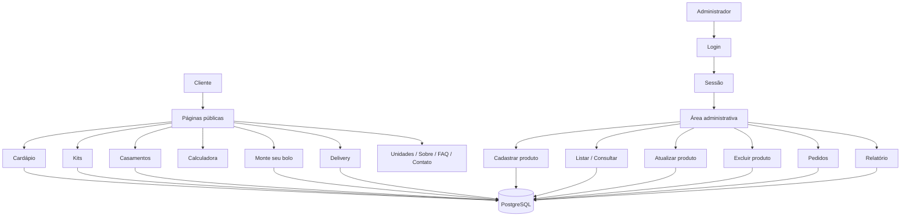

# Elis Patisserie

>*Aluna: Elis Perin*<br>
>*Professor: Jorge, Morato, Platini*<br>
>*Turma: I1D35*<br>

## *Contextualização*

### 1. Introdução

Com o crescimento das compras e dos pedidos realizados pela internet, muitas confeitarias passaram a precisar de sistemas que não sirvam apenas para divulgar seus produtos, mas também para ajudar na organização do cardápio, dos pedidos e das informações do negócio.

O projeto "Elis Patisserie" nasce dessa ideia. Trata-se de um sistema web para uma confeitaria inspirada na pâtisserie francesa e na estética retrô dos anos 50, 60 e 70. O site apresenta produtos como bolos, tortas, macarons, kits comemorativos e doces para casamentos, além de permitir que o cliente faça pedidos e monte um bolo personalizado.

### 2. Razão de eu escolher a Confeitaria

Confeitarias que controlam seus produtos e pedidos de forma manual podem acabar utilizando cadernos, planilhas ou anotações separadas. Esse modelo pode gerar problemas como:

- Dificuldade em manter o cardápio atualizado;<BR>
- Falta de controle sobre produtos ativos e inativos;<BR>
- Dificuldade em acompanhar os pedidos recebidos;<BR>
- Falhas na atualização do status dos pedidos;<BR>
- Estoque desatualizado dos produtos;<BR>
- Ausência de relatórios que ajudem na organização da confeitaria.

Além disso, eu queria desenvolver um projeto em que eu pudesse trabalhar tanto a parte de programação e banco de dados quanto a parte visual. Por isso escolhi uma confeitaria com técnica francesa e uma identidade retrô, usando tons pastel e referências das décadas de 1950, 1960 e 1970.

### 3. Objetivos

#### 3.1 Objetivo Geral

Desenvolver um sistema web para uma confeitaria, permitindo a apresentação e consulta dos produtos, o registro de pedidos e o gerenciamento das informações pela área administrativa.

#### 3.2 Objetivos Específicos

- Cadastrar e gerenciar produtos da confeitaria;
- Permitir a consulta e o filtro dos produtos do cardápio;
- Registrar pedidos de delivery, retirada e bolo personalizado;
- Criar uma calculadora de quantidade de bolo e docinhos;
- Controlar o acesso à área administrativa por login;
- Permitir a atualização do status dos pedidos;
- Gerar um relatório que auxilie no controle de produtos e pedidos;
- Manter uma identidade visual coerente com o tema retrô e com a confeitaria francesa.

### 4. Tecnologias Utilizadas

|Tecnologia|Finalidade|
|----------|----------|
|PHP|Linguagem de programação do back-end|
|Moba/PSQL / PostgreSQL|Armazenamento dos dados|
|PDO|Conexão do PHP com o PostgreSQL|
|HTML5, CSS|Construção e estilização da interface|
|Visual Studio Code|Ambiente de desenvolvimento|

--------------------------------------------

## *Requisitos do Sistema*

### *Requisitos Funcionais*

|Requisitos|Explicação|
|----------|----------|
|RF01|O sistema deve permitir o cadastro, consulta, atualização e exclusão de produtos (nome, categoria, preço, estoque, unidade, descrição, rendimento, alérgenos, imagem e ativo).|
|RF02|O sistema deve permitir login e logout do administrador.|
|RF03|O sistema deve permitir listar os produtos e filtrar o cardápio por categoria e unidade.|
|RF04|O sistema deve exibir produtos específicos nas páginas de Kits Comemorativos e Casamentos.|
|RF05|O sistema deve permitir calcular uma sugestão de bolo e docinhos de acordo com o número de convidados.|
|RF06|O sistema deve permitir montar um bolo personalizado e calcular o valor de acordo com o peso escolhido.|
|RF07|O sistema deve registrar pedidos de delivery, retirada e bolo personalizado, contendo cliente, produto, quantidade, unidade, data, período, status e total.|
|RF08|O sistema deve exibir os pedidos cadastrados, permitir atualizar o status de cada pedido e gerar um relatório de produtos, estoque e pedidos.|

### *Requisitos Não Funcionais*

|Requisitos|Explicação|
|----------|----------|
|RNF01|O sistema deve ser desenvolvido em PHP, usando o VS Code como ambiente de desenvolvimento.|
|RNF02|Os dados devem ser armazenados em um banco de dados relacional PostgreSQL.|
|RNF03|A comunicação com o banco deve ser feita com PDO.|
|RNF04|As consultas que recebem valores devem utilizar prepared statements com `prepare()` e `bindParam()`.|
|RNF05|O acesso às páginas administrativas deve ser controlado por sessão.|
|RNF06|A estrutura do projeto deve separar as páginas públicas, administração, login, banco, funções, imagens e estilos.|
|RNF07|A interface deve se adaptar ao navegador utilizando `meta viewport`, larguras máximas e imagens ajustáveis.|
|RNF08|A interface deve ser intuitiva e manter uma identidade visual coerente com o tema retrô e com a confeitaria francesa.|
|RNF09|Os formulários devem possuir campos obrigatórios identificados com `required`.|
|RNF10|O site deve funcionar nos principais navegadores atuais que tenham acesso ao servidor PHP.|
|RNF11|Produtos, pedidos e usuários devem permanecer armazenados no PostgreSQL depois que o navegador for fechado.|
|RNF12|Os arquivos reutilizados, como cabeçalho, rodapé e funções, devem ficar separados para facilitar alterações.|
|RNF13|O código deve possuir comentários que ajudem na leitura e na explicação das funções do sistema.|
|RNF14|As credenciais reais do PostgreSQL não devem ser publicadas em um repositório público.|

## *Organização do código*

```texto
elis-patisserie/
├── index.php                  *página inicial da confeitaria*
├── cardapio.php               *cardápio e filtros dos produtos*
├── kits.php                   *exibição dos Kits Comemorativos*
├── casamentos.php             *exibição dos produtos para Casamentos*
├── calculadora.php            *cálculo de bolo e docinhos*
├── monte-bolo.php             *montagem e cadastro do bolo personalizado*
├── delivery.php               *registro de pedidos de delivery e retirada*
├── unidades.php               *informações das unidades da confeitaria*
├── sobre.php                  *informações sobre a Elis Patisserie*
├── faq.php                    *perguntas frequentes*
├── contato.php                *informações de contato*
├── documentacao.md            *documentação geral do projeto*
├── app/                       *gerenciamento do sistema*
│   ├── pedidos.php            *listagem e atualização dos pedidos*
│   ├── produto-cadastrar.php  *cadastro de produtos*
│   ├── produto-listar.php     *listagem de produtos*
│   ├── produto-consultar.php  *consulta de produto por ID*
│   ├── produto-atualizar.php  *atualização/edição de produtos*
│   ├── produto-excluir.php    *exclusão de produtos*
│   └── relatorio.php          *relatório de produtos e pedidos*
├── database/                  *camada de persistência de dados*
│   ├── connect.php            *script de conexão com o banco de dados*
│   └── dados.pgsql            *criação das tabelas, dados e testes SQL*
├── includes/                  *componentes reutilizáveis de interface e lógica comum*
│   ├── footer.php             *rodapé compartilhado do site*
│   ├── functions.php          *funções utilizadas no sistema*
│   ├── header.php             *cabeçalho da parte pública*
│   └── header_admin.php       *cabeçalho da área administrativa*
├── login/                     *controle de autenticação e segurança*
│   ├── login.php              *login do administrador*
│   ├── logout.php             *desconexão do administrador*
│   └── verifica_user.php      *verificação da sessão*
├── imagens/                   *imagens utilizadas no site*
└── style/                     *arquivos de estilização CSS*
    └── style.css              *layout das páginas*
```

## *Diagrama do Sistema*



## *Como entrar no meu projeto*

### 1. Preparar a aplicação

#### Pré-requisitos

- PHP instalado e disponível no `Path` do Windows, com as extensões `PDO` e `pdo_pgsql` habilitadas e suporte a sessões.
- PostgreSQL instalado e em execução no servidor utilizado pela aplicação.
- MobaXterm, caso seja necessário acessar remotamente o PostgreSQL do ambiente da escola.
- Git, caso o projeto seja obtido por clonagem.
- Navegador web no Windows.

#### 1.1. Obter o projeto

No PowerShell ou terminal PowerShell do VS Code:

```powershell
git clone URL_DO_REPOSITORIO elis-patisserie
Set-Location .\elis-patisserie
```

A clonagem exige acesso ao repositório. Se já possui os arquivos, abra no VS Code a pasta `elis-patisserie`, que contém o `index.php`.

Confira a presença de `database/connect.php` e `database/dados.pgsql`. Esses arquivos são utilizados para a conexão e para a estrutura do banco.

#### 1.2. Conferir os caminhos da conexão

A pasta atual do banco é `database/`.

O arquivo:

```text
includes/functions.php
```

carrega a conexão usando:

```php
require_once __DIR__ . '/../database/connect.php';
```

As páginas que precisam acessar o banco carregam `includes/functions.php`, e as páginas administrativas também carregam `login/verifica_user.php`.

Confira esses caminhos antes de iniciar a aplicação.

### 2. Configurar banco

A aplicação utiliza o banco:

```text
elis_patisserie
```

e as tabelas:

```text
produtos
pedidos
usuarios
```

Os comandos utilizados para criar e testar as tabelas estão no arquivo:

```text
database/dados.pgsql
```

#### 2.1. Criar o usuário e o banco

No ambiente utilizado para o PostgreSQL, crie ou utilize um usuário próprio para a aplicação, com permissão para acessar o banco `elis_patisserie`.

O usuário da aplicação não deve ser o superusuário administrativo `postgres`.

Depois, crie ou selecione o banco:

```text
elis_patisserie
```

Use os dados do usuário criado/configurado posteriormente no arquivo `database/connect.php`.

#### 2.2. Restaurar o dump

No projeto atual, o arquivo disponível para preparar o banco é:

```text
database/dados.pgsql
```

Abra esse arquivo pelo **New Query** do PostgreSQL Explorer ou pela ferramenta utilizada no ambiente e execute os comandos de criação das tabelas e os `INSERT` necessários.

As tabelas esperadas são:

```text
produtos
pedidos
usuarios
```

Depois confira:

```sql
SELECT * FROM produtos;
SELECT * FROM pedidos;
SELECT * FROM usuarios;
```

Quando o dump final do banco for criado para a entrega, ele poderá ser utilizado para restaurar essa mesma estrutura e os dados.

### 3. Conectar ao banco e abrir no localhost

#### 3.1. Configurar o arquivo de conexão

No VS Code, abra `database/connect.php`. Para utilizar a configuração do seu banco, altere as seguintes partes:

```php
<?php

$host = "IP_DO_BANCO/SERVIDOR";
$dbname = "elis_patisserie";
$user = "USUARIO_DO_BANCO";
$pass = "SENHA_DO_BANCO";

?>
```

- `$host` deve receber o endereço do PostgreSQL;
- `$dbname` deve continuar como `elis_patisserie`;
- `$user` deve receber o usuário da aplicação;
- `$pass` deve receber a senha desse usuário.

Não publique a senha real no GitHub.

#### 3.2. Iniciar o PHP pelo PowerShell

No VS Code, abra um terminal **PowerShell na pasta que contém a pasta `elis-patisserie`**.

Execute:

```powershell
php -S localhost:8000
```

Abra:

```text
http://localhost:8000/elis-patisserie/
```

no navegador.

Para acessar diretamente a área administrativa:

```text
http://localhost:8000/elis-patisserie/login/login.php
```

#### 3.3. Criar o primeiro acesso e conferir

A tabela `usuarios` precisa possuir um administrador cadastrado.

1. Confira os usuários existentes com `SELECT * FROM usuarios;`.
2. Caso esteja preparando um banco novo, cadastre um usuário de teste na tabela `usuarios`.
3. Entre em `/login/login.php` com o e-mail e a senha cadastrados.
4. Acesse `/app/produto-cadastrar.php` e cadastre um produto de teste.
5. Abra `/app/produto-listar.php` e confira o cadastro.
6. Acesse `/app/produto-consultar.php` e consulte o produto pelo ID.
7. Acesse `/app/produto-atualizar.php` e altere alguma informação.
8. Acesse `/app/produto-excluir.php` e exclua o produto de teste.
9. Faça um pedido em `/delivery.php` ou `/monte-bolo.php`.
10. Confira o pedido em `/app/pedidos.php` e altere seu status.
11. Abra `/app/relatorio.php` e confira os dados calculados.

A senha do administrador é armazenada em texto simples no esquema atual. Use somente credenciais de teste enquanto essa pendência existir.

Para encerrar, pressione `Ctrl+C` no terminal do PHP. Os produtos e pedidos permanecem salvos no PostgreSQL.

#### 3.4. Problemas comuns

| Problema | O que conferir |
|---|---|
| `php` não é reconhecido | PHP disponível no `Path` do Windows, conforme os pré-requisitos. |
| `could not find driver` | Extensão `pdo_pgsql` habilitada na instalação PHP utilizada. |
| Conexão recusada | PostgreSQL ligado e endereço correto em `$host`. |
| Falha de autenticação | Usuário, nome do banco ou senha informados em `connect.php`. |
| `relation "produtos" does not exist` | Tabela `produtos` criada no banco `elis_patisserie`. |
| `relation "pedidos" does not exist` | Tabela `pedidos` criada no banco `elis_patisserie`. |
| `relation "usuarios" does not exist` | Tabela `usuarios` criada no banco `elis_patisserie`. |
| Usuário ou senha inválidos | Dados cadastrados na tabela `usuarios`. |
| Produto não aparece no site | Campo `ativo`, categoria, unidade e dados cadastrados no banco. |
| Pedido não aparece na administração | Cadastro na tabela `pedidos` e conexão com o banco correto. |
| Imagem não aparece | Caminho salvo na coluna `imagem` e arquivo existente na pasta `imagens/`. |
| Página sem estilo ou links quebrados | Pasta principal com o nome `elis-patisserie` e endereço aberto pelo localhost correto. |

Esses passos são um roteiro de verificação; o funcionamento completo ainda deve ser conferido no ambiente real.
